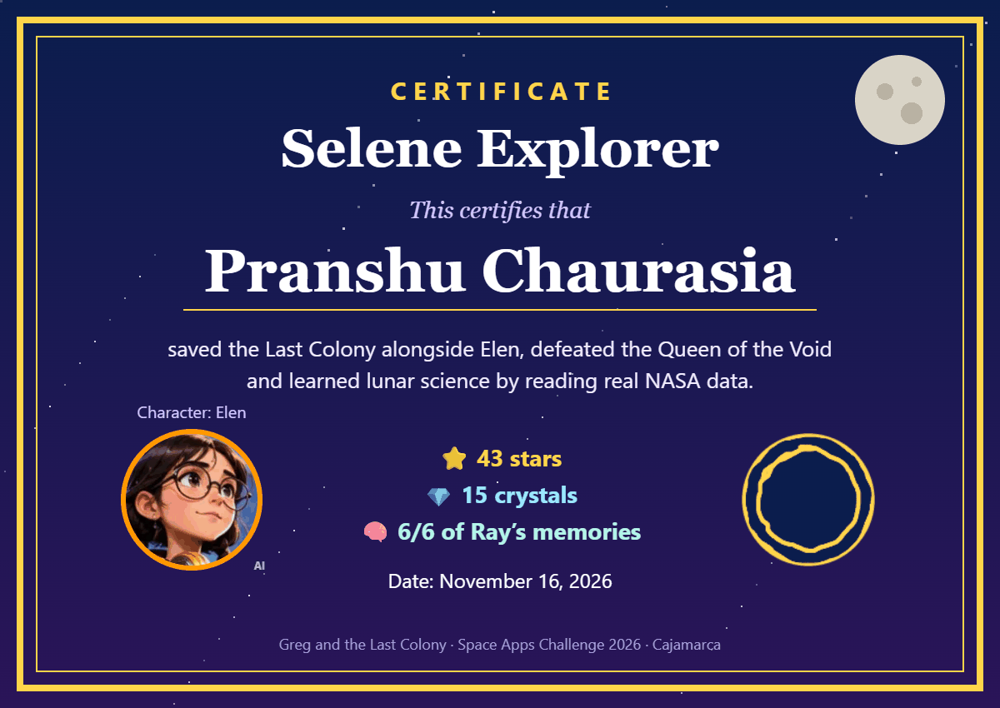

# Greg and the Last Colony · Greg y la Colonia Última

**▶ Play now, have fun, and learn about lunar missions realistically while earning achievements and a mission completion certificate./ Juega ahora, diviértete y aprende sobre las misiones lunares de forma realista mientras consigues logros y un certificado de finalización de la misión.: https://abatsigame.pranshuchaurasia.dev/**

[English](#english) · [Español](#español)

---

## English

### About the game

A free, bilingual (Spanish / English), story-driven browser game for students aged 15+. High school students from Cajamarca (Peru) recover 5 energy cores, travel to the Moon and defeat the Queen of the Void.
Along the way: Hands-on lunar physics mini-games, real NASA GISTEMP and FIRMS data, a NASA fact in every game, an AR camera mode and phone-friendly controls.

It takes about **20–30 minutes** to finish. Explore. Learn. Play. Save the Moon!

### What it is

*Greg and the Last Colony* is a free, bilingual (Spanish / English) educational browser game about the Moon and about our own planet, made for the **NASA Space Apps Challenge 2026 — Cajamarca (Peru) local event**.

It is the year 2087 and a mysterious signal, **NOX-Ω**, travels from the Moon to Earth. Greg, a student who dreams of becoming an astronaut, explores his school, *I.E. Aula Estelar* in Cajamarca, Peru, with Orbi (an alien archivist and guide), Elen and Joseph. Each area of the school teaches a piece of real science, and each lesson recovers one of the five **energy cores** for **Selene**, the Last Colony on the Moon, which the Queen of the Void wants to devour. Along the way, Ray shows Greg real NASA satellite data about Earth's temperature and fires. With all five energy cores, the Last Explorers fly from Cajamarca to the Moon to save Selene.

It runs in any modern browser, on phones and computers, with no installation and no account. Progress is saved in the browser.

### How to play

1. Press **▶ START**, watch (or skip) the short intro and choose your character.
2. Move around the school map by **tapping/clicking** where you want to go, or with the **arrow keys / WASD**.
3. Walk into a zone marked with a **cyan circle** to open its activities. The **golden circle** marks the recommended next zone; tap **💡** for a hint from Orbi.
4. Each activity gives **⭐ stars** and unlocks facts (🎒) and achievements (🏆). Pick up the **8 star fragments ✦** hidden on the map for bonus stars.
5. After completing **two zones**, the observatory dome opens: **Ray's Signal**, with real NASA data.
6. Once you have the 5 energy cores from the five main zones, open the **Main mission** and **face the Queen of the Void**: a short *Journey to the Moon* cutscene (skippable, and replayable from the Main mission) takes the Last Explorers from Cajamarca to Selene, then comes a quiz battle where your friends help you.

⚙️ Settings: language, theme, music and sound effects, reset progress, back to the title screen. The **📜 Credits** page lists the team, sources and AI use.

### 🏅 Certificate

Completing all missions and defeating the Queen of the Void unlocks a downloadable **"Selene Explorer" certificate** with the player's name, their character, stars, crystals, Ray's memories and their mission patch.

<p align="center">
  <br>
  <em>Sample certificate (Pranshu Chaurasia)</em>
</p>

### Zones and mini-games

| Zone | Mini-games | What you learn |
|---|---|---|
| 📚 **Classrooms** | 📖 Course: the Moon from zero · ❓ Lunar quiz | Distance, atmosphere, radiation, temperature, effects on the body, missions |
| 🚀 **Digital Lab** | 🚀 Lunar landing · ☀️ Solar storm | Land under 2.5 m/s with lunar gravity (1.62 m/s²); build a radiation shield with limited mass |
| 🏀 **Sports Court** | 🏀 Lunar jump · 🧑‍🚀 Astronaut training | Why you jump ~6× higher on the Moon; planning sleep, exercise and work |
| 🌱 **Green Zones** | 🌱 Lunar greenhouse · 🌡️ Thermal control | Balancing oxygen between plants and crew; keeping a habitat between 15 and 25 °C |
| 🎤 **Auditorium** | 🎤 Timeline · 📷 Augmented reality | Ordering Moon missions (Luna 2, Apollo 11…); low-cost AR with the phone camera (Moon, lander, radiation, suit) |
| 📡 **Ray's Signal** | 📈 Earth's thermometer · 🔥 Fire map | Reading a real global temperature chart; reading a real satellite fire map |
| 🛰️ **Final** (on the Moon) | 🚀 Journey to the Moon · ⚔️ Queen of the Void battle | Escape velocity, the trip to the Moon, landing without parachutes; review quiz of everything learned |

### NASA data used

The **Ray's Signal** zone uses real NASA Earth data. The files are stored in the game ([`public/data/`](public/data/)), so the zone also works offline once loaded. Snapshot downloaded **14 Nov 2026 (UTC)**.

- **NASA GISTEMP v4 — Global Land-Ocean Temperature Index**
  CSV: https://data.giss.nasa.gov/gistemp/tabledata_v4/GLB.Ts+dSST.csv · Dataset page: https://data.giss.nasa.gov/gistemp/
  Annual global temperature anomaly (J-D column, 1880–2025, vs the 1951–1980 average). Used in *Earth's thermometer*: 5 rounds of "which year was hotter?", then the full chart.
- **NASA FIRMS — MODIS Collection 6.1 active fires, global, last 24 h**
  CSV: https://firms.modaps.eosdis.nasa.gov/data/active_fire/modis-c6.1/csv/MODIS_C6_1_Global_24h.csv · Data files: https://firms.modaps.eosdis.nasa.gov/active_fire/
  300 high-confidence fires (confidence ≥ 80; a reproducible random sample of 4,221, detected 13–14 Nov 2026) in the *Fire map*: guess which continent had the most fires. The world map is our own simplified drawing.

The science facts in the quizzes, lessons and mini-games come from these NASA pages:

- NASA Science — Moon facts: https://science.nasa.gov/moon/facts/
- NASA Science — Earth's Moon: https://science.nasa.gov/moon/
- NASA — Apollo 11 mission: https://www.nasa.gov/mission/apollo-11/
- NASA — Apollo 17 mission: https://www.nasa.gov/mission/apollo-17/
- NASA — Artemis: https://www.nasa.gov/humans-in-space/artemis/
- NASA — Spacewalk Spacesuit Basics: https://www.nasa.gov/centers-and-facilities/johnson/spacewalk-spacesuit-basics/

#### "🚀 NASA Fact" cards (one per mini-game)

Every mini-game has a **🚀 NASA Fact** button in its header, and the card also appears on its result screen. Orbi presents one real fact, written in our own kid-friendly words, with a text link to the NASA page it comes from (no logos). Facts and links live in [`lib/content/nasaFacts.ts`](lib/content/nasaFacts.ts); all links checked (HTTP 200) on 15 Nov 2026.

- **Lunar quiz** — Moon Facts: https://science.nasa.gov/moon/facts/
- **Course: the Moon from zero** — Earth's Moon: https://science.nasa.gov/moon/
- **Lunar landing** — Apollo 11: https://www.nasa.gov/mission/apollo-11/
- **Solar storm** — Positive, Negative or Neutral, It All Matters: NASA Explains Space Radiation: https://www.nasa.gov/humans-in-space/positive-negative-or-neutral-it-all-matters-nasa-explains-space-radiation/
- **Thermal control** — Moon Facts: https://science.nasa.gov/moon/facts/
- **Lunar jump** — Top Moon Questions: https://science.nasa.gov/moon/top-moon-questions/
- **Astronaut training** — Counteracting Bone and Muscle Loss in Microgravity: https://www.nasa.gov/missions/station/iss-research/counteracting-bone-and-muscle-loss-in-microgravity/
- **Lunar greenhouse** — Advanced Oxygen Generation: https://www.nasa.gov/podcasts/houston-we-have-a-podcast/advanced-oxygen-generation/
- **Timeline** — Artemis II: NASA's First Crewed Lunar Flyby in 50 Years: https://www.nasa.gov/mission/artemis-ii/
- **Mission patch** — Apollo Mission Patches: https://science.nasa.gov/resource/apollo-mission-patches/
- **Lunar ping pong** — 50 Years Ago: Apollo 14 Lands at Fra Mauro: https://www.nasa.gov/history/50-years-ago-apollo-14-lands-at-fra-mauro/
- **Augmented reality** — What Is a Spacesuit? (Grades K-4): https://www.nasa.gov/learning-resources/for-kids-and-students/what-is-a-spacesuit-grades-k-4/
- **Final battle: the Queen of the Void** — What Is the Artemis Program? (Grades K-4): https://www.nasa.gov/learning-resources/for-kids-and-students/what-is-the-artemis-program-grades-k-4/
- *Earth's thermometer* and *Fire map* show their NASA dataset (GISTEMP, FIRMS, above) in the same "Source: NASA — …" line.

This game does not use NASA logos, insignia or branding, and it is not endorsed by NASA.

### Use of artificial intelligence (AI)

- **Images:** the school map, the key art and the character sheet were generated with AI (AI text-to-image generation tool). They carry the label "AI-generated image" inside the file itself and also on top of the image in the game. The portraits and map characters are crops of those same images and carry a small "AI" mark.
- **Code:** developed by the team with AI-assisted programming tools.
- **Sound and music:** synthesised in the browser with Web Audio (no audio files).

### Roadmap

This web game is the **MVP** of the team's Game Design Document (GDD v2). The planned full version will be built in **Unity with AR Foundation**, with **8 scenes** that take the Last Explorers from Cajamarca to the Last Colony.

### Team

- Valeria Alexandra Villacorta Landeo — [@vale34villa1](https://github.com/vale34villa1)
- Pranshu Chaurasia — [@MrPC7](https://github.com/MrPC7)
- Elida Nuñez Vásquez
- Miguel Angel Vilca Mamani

### Tech stack

- [Next.js](https://github.com/vercel/next.js) 16 (App Router, static export) + [React](https://github.com/facebook/react) 19 + [TypeScript](https://github.com/microsoft/TypeScript)
- [Zustand](https://github.com/pmndrs/zustand): game state and saving in `localStorage`
- [Chart.js](https://github.com/chartjs/Chart.js) + [react-chartjs-2](https://github.com/reactchartjs/react-chartjs-2): temperature chart
- [Tailwind CSS](https://github.com/tailwindlabs/tailwindcss) 4 and CSS modules; SVG for the fire map; Canvas + `getUserMedia` for AR; Web Audio for sound
- Python 3 (standard library) for the data build; [Pillow](https://github.com/python-pillow/Pillow) for image watermarking
- Hosted on **GitHub Pages** at the custom domain `abatsigame.pranshuchaurasia.dev` ([`public/CNAME`](public/CNAME)), deployed by GitHub Actions ([`.github/workflows/deploy.yml`](.github/workflows/deploy.yml)) on every push to `main`

All game text lives in [`lib/content/`](lib/content/) as `{ es, en }` pairs.

### Run locally

Requirements: **Node.js 22** (the version used in CI) and npm.

```bash
npm install
npm run dev          # http://localhost:3000
```

Other commands:

```bash
npm run lint         # ESLint
npm run check:i18n   # check that every text has both Spanish and English
npm run build        # static export to out/
```

`npm run build` reads [`.env.production`](.env.production): an empty `NEXT_PUBLIC_BASE_PATH` (the site is served at the root of https://abatsigame.pranshuchaurasia.dev/) and `NEXT_PUBLIC_SITE_URL` for the absolute Open Graph URLs. To preview the export, serve `out/` at the root of any static server. To host it under a sub-path instead, set `NEXT_PUBLIC_BASE_PATH=/<sub-path>` before building.

### Rebuild the NASA data

The JSON files in [`public/data/`](public/data/) are generated by [`scripts/build_data.py`](scripts/build_data.py) (Python 3.10+, standard library only):

```bash
python scripts/build_data.py              # download both CSVs and rebuild gistemp.json and firms.json
python scripts/build_data.py --offline    # rebuild from CSVs already saved in scripts/raw/
```

The script saves the raw CSVs to `scripts/raw/` and writes the snapshot date into each JSON. If a download fails, it prints the URL: download that CSV by hand into `scripts/raw/` with the file name shown and run again with `--offline`. The FIRMS file only covers the **last 24 hours**, so every rebuild gives a new set of fires. After rebuilding, update the dates and counts in [`lib/content/credits.ts`](lib/content/credits.ts) (and in the "NASA data used" section above), then commit the new JSON files.

### License

The source code is released under the [MIT License](LICENSE). The art, characters, story and texts are licensed under [CC BY-NC 4.0](LICENSE-ASSETS.md); NASA data and facts follow NASA's own usage guidelines.

---

## Español

### Sobre el juego

Un juego de navegador gratuito, bilingüe (español / inglés) y con historia, para estudiantes de 10 años en adelante. Chicos y chicas de Cajamarca (Perú) recuperan 5 núcleos de energía, viajan a la Luna y derrotan a la Reina del Vacío.
En el camino: mini-juegos prácticos de física lunar, datos reales de la NASA (GISTEMP y FIRMS), un dato NASA en cada juego, cámara de realidad aumentada y controles para celular.
Se termina en unos **20–30 minutos**.

### Qué es

*Greg y la Colonia Última* es un juego educativo gratuito y bilingüe (español / inglés) para el navegador, sobre la Luna y sobre nuestro propio planeta, hecho para el **NASA Space Apps Challenge 2026 — sede Cajamarca (Perú)**.

Es el año 2087 y una señal misteriosa, **NOX-Ω**, viaja desde la Luna hasta la Tierra. Greg, un estudiante que sueña con ser astronauta, explora su colegio, la *I.E. Aula Estelar* de Cajamarca (Perú), junto a Orbi (un archivista alienígena y su guía), Elen y Joseph. Cada zona del colegio enseña algo de ciencia real, y cada lección recupera uno de los cinco **núcleos de energía** para **Selene**, la Colonia Última de la Luna, que la Reina del Vacío quiere devorar. En el camino, Ray le muestra a Greg datos reales de satélites de la NASA sobre la temperatura y los incendios de la Tierra. Con los cinco núcleos de energía, los Últimos Exploradores viajan de Cajamarca a la Luna para salvar Selene.

Funciona en cualquier navegador moderno, en celulares y computadoras, sin instalar nada y sin cuenta. El progreso se guarda en el navegador.

### Cómo jugar

1. Pulsa **▶ EMPEZAR**, mira (o salta) la introducción y elige tu personaje.
2. Muévete por el mapa del colegio **tocando/haciendo clic** donde quieras ir, o con las **flechas / WASD**.
3. Entra a una zona marcada con un **círculo celeste** para abrir sus actividades. El **círculo dorado** marca la siguiente zona recomendada; toca **💡** para recibir una pista de Orbi.
4. Cada actividad da **⭐ estrellas** y desbloquea datos (🎒) y logros (🏆). Recoge los **8 fragmentos de estrella ✦** escondidos en el mapa para ganar estrellas extra.
5. Al completar **dos zonas** se abre la cúpula del observatorio: **La Señal de Ray**, con datos reales de la NASA.
6. Cuando tengas los 5 núcleos de energía de las cinco zonas principales, abre la **Misión principal** y **enfrenta a la Reina del Vacío**: una breve escena, *Viaje a la Luna* (se puede saltar y volver a ver desde la Misión principal), lleva a los Últimos Exploradores de Cajamarca a Selene; luego viene una batalla de preguntas en la que te ayudan tus amigos.

⚙️ Ajustes: idioma, tema, música y efectos de sonido, reiniciar el progreso y volver a la portada. La página **📜 Créditos** muestra el equipo, las fuentes y el uso de IA.

### 🏅 Certificado

Completar todas las misiones y derrotar a la Reina del Vacío desbloquea un **certificado de «Explorador/a de Selene»** descargable, con el nombre del jugador, su personaje, estrellas, cristales, recuerdos de Ray y su parche de misión.

<p align="center">
  <br>
  <em>Certificado de ejemplo (Pranshu Chaurasia)</em>
</p>

### Zonas y mini-juegos

| Zona | Mini-juegos | Qué aprendes |
|---|---|---|
| 📚 **Aulas** | 📖 Curso: la Luna desde cero · ❓ Quiz lunar | Distancia, atmósfera, radiación, temperatura, efectos en el cuerpo, misiones |
| 🚀 **Laboratorio Digital** | 🚀 Aterrizaje lunar · ☀️ Tormenta solar | Alunizar a menos de 2,5 m/s con la gravedad lunar (1,62 m/s²); armar un escudo antirradiación con masa limitada |
| 🏀 **Cancha Deportiva** | 🏀 Salto lunar · 🧑‍🚀 Entrenamiento de astronauta | Por qué en la Luna saltas ~6 veces más alto; organizar sueño, ejercicio y trabajo |
| 🌱 **Zonas Verdes** | 🌱 Invernadero lunar · 🌡️ Control térmico | Equilibrar el oxígeno entre plantas y tripulación; mantener un hábitat entre 15 y 25 °C |
| 🎤 **Auditorio** | 🎤 Línea del tiempo · 📷 Realidad aumentada | Ordenar misiones lunares (Luna 2, Apolo 11…); realidad aumentada de bajo costo con la cámara del celular (Luna, módulo lunar, radiación, traje) |
| 📡 **La Señal de Ray** | 📈 El termómetro de la Tierra · 🔥 Mapa de incendios | Leer una gráfica real de temperatura global; leer un mapa real de incendios visto por satélite |
| 🛰️ **Final** (en la Luna) | 🚀 Viaje a la Luna · ⚔️ Batalla contra la Reina del Vacío | Velocidad de escape, el viaje a la Luna, alunizar sin paracaídas; repaso de todo lo aprendido en forma de preguntas |

### Datos de la NASA usados

La zona **La Señal de Ray** usa datos reales de la NASA sobre la Tierra. Los archivos están guardados en el juego ([`public/data/`](public/data/)), así que la zona también funciona sin internet una vez cargada. Datos descargados el **14 nov 2026 (UTC)**.

- **NASA GISTEMP v4 — Índice global de temperatura tierra-océano**
  CSV: https://data.giss.nasa.gov/gistemp/tabledata_v4/GLB.Ts+dSST.csv · Página del conjunto de datos: https://data.giss.nasa.gov/gistemp/
  Anomalía anual de temperatura global (columna J-D, 1880–2025, respecto al promedio 1951–1980). Se usa en *El termómetro de la Tierra*: 5 rondas de «¿qué año fue más caluroso?» y luego la gráfica completa.
- **NASA FIRMS — Incendios activos MODIS Colección 6.1, global, últimas 24 h**
  CSV: https://firms.modaps.eosdis.nasa.gov/data/active_fire/modis-c6.1/csv/MODIS_C6_1_Global_24h.csv · Archivos de datos: https://firms.modaps.eosdis.nasa.gov/active_fire/
  300 incendios de confianza alta (confianza ≥ 80; muestra aleatoria reproducible de 4.221, detectados el 13–14 nov 2026) en el *Mapa de incendios*: adivina qué continente tuvo más incendios. El mapa del mundo es un dibujo simplificado propio.

Los datos científicos de los quizzes, lecciones y mini-juegos provienen de estas páginas de la NASA:

- NASA Science — La Luna: datos: https://science.nasa.gov/moon/facts/
- NASA Science — La Luna: https://science.nasa.gov/moon/
- NASA — Misión Apolo 11: https://www.nasa.gov/mission/apollo-11/
- NASA — Misión Apolo 17: https://www.nasa.gov/mission/apollo-17/
- NASA — Artemis: https://www.nasa.gov/humans-in-space/artemis/
- NASA — Spacewalk Spacesuit Basics (conceptos básicos del traje espacial): https://www.nasa.gov/centers-and-facilities/johnson/spacewalk-spacesuit-basics/

#### Tarjetas «🚀 Dato NASA» (una por mini-juego)

Cada mini-juego tiene un botón **🚀 Dato NASA** en su encabezado, y la tarjeta también aparece en su pantalla de resultado. Orbi presenta un dato real, contado con nuestras propias palabras para niños, con un enlace de texto a la página de la NASA de donde viene (sin logotipos). Los datos y enlaces están en [`lib/content/nasaFacts.ts`](lib/content/nasaFacts.ts); todos los enlaces se comprobaron (HTTP 200) el 15 nov 2026.

- **Quiz lunar** — Moon Facts: https://science.nasa.gov/moon/facts/
- **Curso: la Luna desde cero** — Earth's Moon: https://science.nasa.gov/moon/
- **Aterrizaje lunar** — Apollo 11: https://www.nasa.gov/mission/apollo-11/
- **Tormenta solar** — Positive, Negative or Neutral, It All Matters: NASA Explains Space Radiation: https://www.nasa.gov/humans-in-space/positive-negative-or-neutral-it-all-matters-nasa-explains-space-radiation/
- **Control térmico** — Moon Facts: https://science.nasa.gov/moon/facts/
- **Salto lunar** — Top Moon Questions: https://science.nasa.gov/moon/top-moon-questions/
- **Entrenamiento de astronauta** — Counteracting Bone and Muscle Loss in Microgravity: https://www.nasa.gov/missions/station/iss-research/counteracting-bone-and-muscle-loss-in-microgravity/
- **Invernadero lunar** — Advanced Oxygen Generation: https://www.nasa.gov/podcasts/houston-we-have-a-podcast/advanced-oxygen-generation/
- **Línea del tiempo** — Artemis II: NASA's First Crewed Lunar Flyby in 50 Years: https://www.nasa.gov/mission/artemis-ii/
- **Parche de misión** — Apollo Mission Patches: https://science.nasa.gov/resource/apollo-mission-patches/
- **Ping pong lunar** — 50 Years Ago: Apollo 14 Lands at Fra Mauro: https://www.nasa.gov/history/50-years-ago-apollo-14-lands-at-fra-mauro/
- **Realidad aumentada** — What Is a Spacesuit? (Grades K-4): https://www.nasa.gov/learning-resources/for-kids-and-students/what-is-a-spacesuit-grades-k-4/
- **Batalla final: la Reina del Vacío** — What Is the Artemis Program? (Grades K-4): https://www.nasa.gov/learning-resources/for-kids-and-students/what-is-the-artemis-program-grades-k-4/
- *El termómetro de la Tierra* y el *Mapa de incendios* muestran su conjunto de datos de la NASA (GISTEMP, FIRMS, arriba) en la misma línea «Fuente: NASA — …».

Este juego no usa logotipos, insignias ni marcas de la NASA, y no está respaldado por la NASA.

### Uso de inteligencia artificial (IA)

- **Imágenes:** el mapa del colegio, la portada y la lámina de personajes fueron generados con IA (herramienta de generación de imágenes con IA, texto a imagen). Llevan la marca «Imagen generada con IA» dentro del propio archivo y también encima de la imagen en el juego. Los retratos y personajes del mapa son recortes de esas mismas imágenes y llevan una pequeña marca «IA».
- **Código:** desarrollado por el equipo con herramientas de programación asistida por IA.
- **Sonido y música:** generados en el navegador con Web Audio (sin archivos de audio).

### Hoja de ruta

Este juego web es el **MVP** del Documento de Diseño del Juego (GDD v2) del equipo. La versión completa planeada se hará en **Unity con AR Foundation**, con **8 escenas** que llevan a los Últimos Exploradores de Cajamarca a la Colonia Última.

### Equipo

- Valeria Alexandra Villacorta Landeo — [@vale34villa1](https://github.com/vale34villa1)
- Pranshu Chaurasia — [@MrPC7](https://github.com/MrPC7)
- Elida Nuñez Vásquez
- Miguel Angel Vilca Mamani

### Tecnologías

- [Next.js](https://github.com/vercel/next.js) 16 (App Router, exportación estática) + [React](https://github.com/facebook/react) 19 + [TypeScript](https://github.com/microsoft/TypeScript)
- [Zustand](https://github.com/pmndrs/zustand): estado del juego y guardado en `localStorage`
- [Chart.js](https://github.com/chartjs/Chart.js) + [react-chartjs-2](https://github.com/reactchartjs/react-chartjs-2): gráfica de temperatura
- [Tailwind CSS](https://github.com/tailwindlabs/tailwindcss) 4 y módulos CSS; SVG para el mapa de incendios; Canvas + `getUserMedia` para la realidad aumentada; Web Audio para el sonido
- Python 3 (biblioteca estándar) para preparar los datos; [Pillow](https://github.com/python-pillow/Pillow) para la marca de agua de las imágenes
- Publicado en **GitHub Pages** con el dominio propio `abatsigame.pranshuchaurasia.dev` ([`public/CNAME`](public/CNAME)), mediante GitHub Actions ([`.github/workflows/deploy.yml`](.github/workflows/deploy.yml)) en cada push a `main`

Todos los textos del juego están en [`lib/content/`](lib/content/) como pares `{ es, en }`.

### Ejecutar en local

Requisitos: **Node.js 22** (la versión usada en CI) y npm.

```bash
npm install
npm run dev          # http://localhost:3000
```

Otros comandos:

```bash
npm run lint         # ESLint
npm run check:i18n   # comprueba que cada texto tenga español e inglés
npm run build        # exportación estática en out/
```

`npm run build` lee [`.env.production`](.env.production): `NEXT_PUBLIC_BASE_PATH` vacío (el sitio se sirve en la raíz de https://abatsigame.pranshuchaurasia.dev/) y `NEXT_PUBLIC_SITE_URL` para las URL absolutas de Open Graph. Para probar la exportación, sirve `out/` en la raíz de cualquier servidor estático. Para alojarlo bajo una subruta, define `NEXT_PUBLIC_BASE_PATH=/<subruta>` antes de compilar.

### Regenerar los datos de la NASA

Los archivos JSON de [`public/data/`](public/data/) los genera [`scripts/build_data.py`](scripts/build_data.py) (Python 3.10+, solo biblioteca estándar):

```bash
python scripts/build_data.py              # descarga los dos CSV y regenera gistemp.json y firms.json
python scripts/build_data.py --offline    # regenera a partir de los CSV ya guardados en scripts/raw/
```

El script guarda los CSV originales en `scripts/raw/` y escribe la fecha de descarga en cada JSON. Si una descarga falla, muestra la URL: descarga ese CSV a mano en `scripts/raw/` con el nombre indicado y vuelve a ejecutar con `--offline`. El archivo de FIRMS solo cubre las **últimas 24 horas**, así que cada regeneración trae un conjunto nuevo de incendios. Después de regenerar, actualiza las fechas y cifras en [`lib/content/credits.ts`](lib/content/credits.ts) (y en la sección «Datos de la NASA usados» de arriba) y haz commit de los nuevos JSON.

### Licencia

El código fuente se publica bajo la [licencia MIT](LICENSE). El arte, los personajes, la historia y los textos están bajo licencia [CC BY-NC 4.0](LICENSE-ASSETS.md); los datos y la información de la NASA siguen las propias normas de uso de la NASA.
